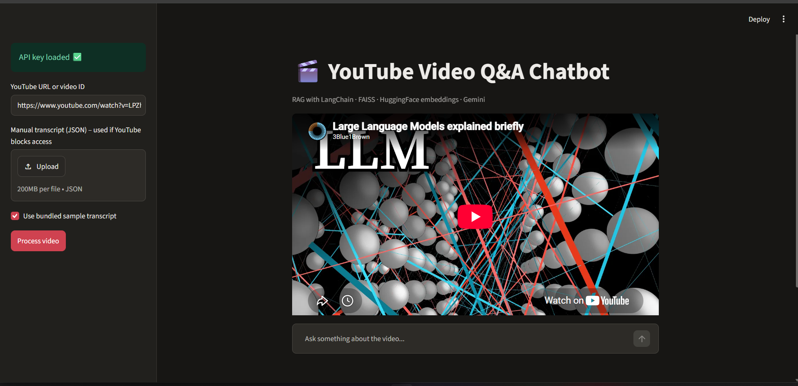
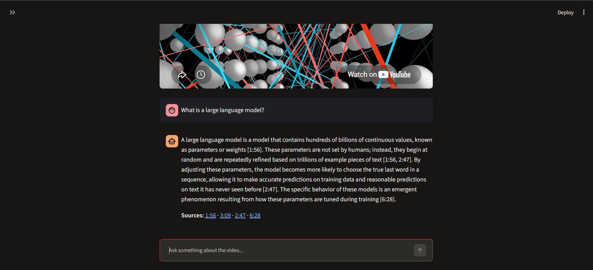

# 🎬 YouTube Video Q&A Chatbot (RAG)

Ask questions about any YouTube video and get answers **grounded in the transcript, with clickable timestamps** pointing to the exact moment it was said.

Built with **LangChain (LCEL)**, **FAISS**, **HuggingFace sentence-transformers**, **Google Gemini**, and **Streamlit**.

> 🔗 Live demo:https://tanisha-youtube-rag.streamlit.app




## ✨ Features
- **Retrieval-Augmented Generation**: answers only from the video's content, says "I don't know" otherwise (reduces hallucination)
- **Timestamped sources**: each answer links to `youtu.be/<id>?t=<seconds>`
- **Robust transcript pipeline**: tries the YouTube Transcript API first, then **falls back to a manual/uploaded transcript** (`text`, `start`, `duration`) when YouTube blocks requests (common on cloud IPs such as Colab)
- **Timestamp-aware chunking**: transcript segments are grouped into ~500-char chunks with overlap, keeping start/end times as metadata
- Local, free embeddings (`all-MiniLM-L6-v2`) + FAISS vector search (top-k = 4)
- Chat UI with history, built in Streamlit

## 🏗️ Architecture
```
YouTube URL ──► Transcript API ──(blocked?)──► Manual JSON fallback
                      │
                      ▼
      Timestamp-aware chunking (500 chars, overlap)
                      │
                      ▼
   HuggingFace embeddings ──► FAISS vector store
                      │
  Question ──► Retriever (top-4) ──► Prompt ──► Gemini ──► Answer + [timestamps]
```

## 📁 Project structure
```
├── app.py              # Streamlit chat UI
├── rag/
│   ├── transcript.py   # YouTube API fetch + manual fallback
│   ├── indexer.py      # chunking, embeddings, FAISS
│   └── chain.py        # LangChain LCEL RAG chain
├── sample_data/        # sample manual transcript (3Blue1Brown – LLMs explained)
├── notebooks/          # original Colab prototype
└── requirements.txt
```

## 🚀 Run locally
```bash
git clone https://github.com/tanishasarthalia-dot/youtube-rag-chatbot.git
cd youtube-rag-chatbot
python -m venv .venv && source .venv/bin/activate   # Windows: .venv\Scripts\activate
pip install -r requirements.txt
cp .env.example .env        # add your GOOGLE_API_KEY (free at aistudio.google.com)
streamlit run app.py
```

## 📝 Manual transcript format
```json
[{"text": "Imagine you happen across a short movie script", "start": 1.14, "duration": 2.836}]
```

## 🔮 Future work
- Whisper-based transcription when no captions exist
- Conversational memory for follow-up questions
- Evaluation with RAGAS (faithfulness / answer relevancy)
- Multi-video knowledge base
